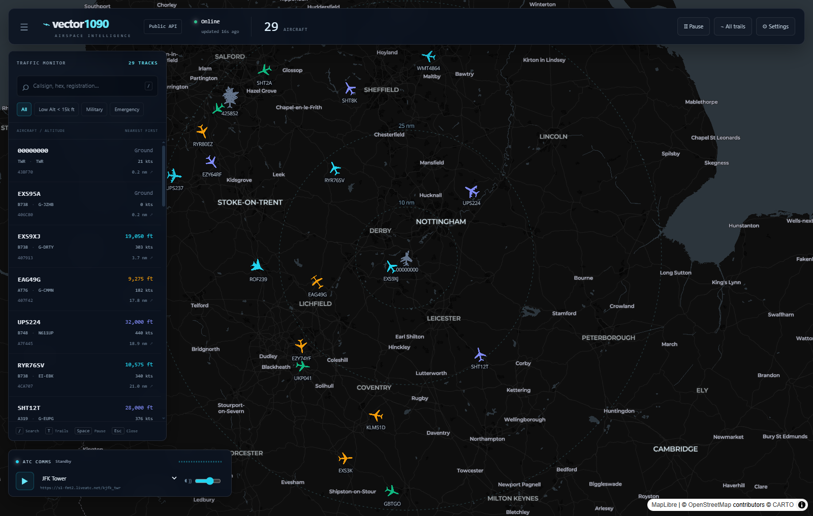
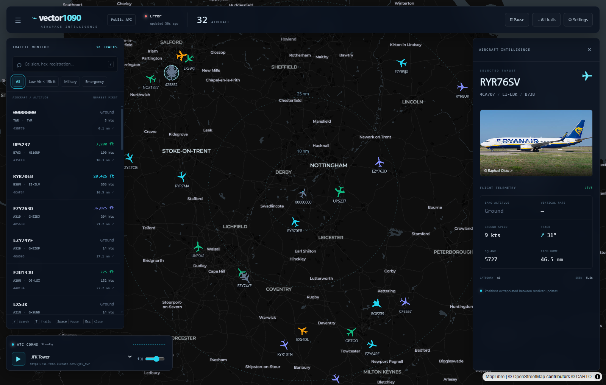

# vector1090

**Live airspace. Clear signals.** A self-hosted, dark-mode ADS-B radar and ATC audio dashboard.

Track public ADS-B traffic or connect your own readsb/tar1090 receiver, with a tactical map, aircraft intelligence and radio audio in one browser tab.



## Quickstart

With Docker and the Compose plugin installed, run from the repository root:

```sh
docker compose up -d
```

Open **http://localhost:3000**. Compose builds the application locally and restarts it unless explicitly stopped. No API key is required for the default public feed.

Optional: copy `.env.example` to `.env` before starting to customize server configuration. After changing it, recreate the service with `docker compose up -d`. After changing application code, use `docker compose up -d --build`.

```sh
docker compose logs -f vector1090
docker compose down
```

> This is an informational dashboard, not a navigation, separation or emergency-response tool. Coverage, identification, position accuracy and availability depend on upstream receivers and services.

## Features

- **Dual-mode feed:** public [adsb.lol](https://adsb.lol/) coverage or your own readsb/tar1090 `aircraft.json`, normalized to one typed response.
- **Considerate polling:** sequential requests, visibility/user pause, an 8-second upstream timeout, rate-limit retry guard (at least 30 seconds) and exponential error backoff capped at 60 seconds. Public polling has a 5-second minimum; local polling has a 1-second minimum.
- **Animated radar:** requestAnimationFrame dead reckoning targeting 60fps, using ground speed, track and observation age. Extrapolation stops at 60 seconds; ground targets stay fixed. Actual frame rate depends on GPU/browser performance.
- **Recognizable category icons:** jet, four-engine heavy, light/prop, helicopter and military silhouettes, rotated to heading/track. Military status takes priority; A7 is helicopter, A5 heavy, A1/A2 light, and A3/A4/default jet.
- **Altitude colors and emergencies:** see the legend below; squawks 7500/7600/7700 override altitude color with a pulsing crimson alert.
- **Airspace context:** 10/25/50 nm range rings, home position, selected/all aircraft trails and altitude-colored trail segments. Metric labels convert the same nautical-mile rings.
- **Aircraft inspector:** registration/type, altitude, speed, climb/descent, track, squawk, distance, category, military/interesting flags and [Planespotters.net](https://www.planespotters.net/) photos with photographer credits. Missing photos and lost signals have explicit states.
- **Search and filters:** callsign, hex, registration or type; low altitude, military and emergency filters apply to both the list and map. List order is nearest to home first, with unknown positions last.
- **ATC audio:** custom stream URLs, example mounts, volume control and analyser-based visualization. CORS failures retry without cross-origin mode and use a simulated visualizer if audio plays.
- **Personal settings:** receiver, home coordinates, radius, units and polling interval persist on the device. Sidebar collapses for smaller screens.

### Altitude and alert legend

| State / barometric altitude | Color |
| --- | --- |
| Ground or unknown | Slate `#64748b` |
| Below 5,000 ft | Emerald `#10b981` |
| 5,000–9,999 ft | Amber `#f59e0b` |
| 10,000–24,999 ft | Cyan `#22d3ee` |
| 25,000 ft and above | Indigo `#818cf8` |
| Squawk 7500 / 7600 / 7700 | Crimson `#ef4444` |

The thresholds always use feet, even when telemetry is displayed in metric units. Emergency meanings are **7500 Hijack**, **7600 Radio Failure**, and **7700 General Emergency**.



## Local development

Use **Node.js 22+** and npm. The Docker build also uses Node 22 Alpine.

```sh
npm install
npm run dev
```

Open http://localhost:3000. For reproducible installs from the committed lockfile, use `npm ci` instead of `npm install`.

```sh
npm run lint
npm run typecheck
npm test
npm run build
npm start
```

`npm test` runs every `tests/*.cjs` file using the cross-platform Node runner in `scripts/test.mjs`. Tests cover normalization, geometry, formatting, styling, filters, hook lifecycles and API behavior without live upstream requests.

Both `predev` and `prebuild` copy MapLibre's installed module worker into `public/`. This generated asset is ignored by Git; do not edit or commit it. Serving it directly avoids Next 14's worker-bundling/minification incompatibility.

The build emits Next's standalone output. Docker starts that output with `node server.js`; `npm start` is the conventional local Next server (Next may print a standalone-output advisory). If packaging standalone output manually, copy `public/` and `.next/static/` beside the generated standalone server as the Dockerfile does.

**Windows / Git Bash:** if the Unix npm shim fails with a toolcache path error, use `npm.cmd install`, `npm.cmd run dev`, etc., or run npm from PowerShell.

## Keyboard shortcuts

| Key | Action |
| --- | --- |
| `/` | Open the sidebar and focus aircraft search |
| `T` | Toggle all aircraft trails |
| `Space` | Pause / resume feed polling |
| `Esc` | Close settings if open; otherwise clear aircraft selection |

Shortcuts other than Escape are ignored while typing in an input, select, textarea or editable element. Settings also supports Tab focus trapping and Cancel without saving.

## Configuration

Server configuration is read at request time. Compose interpolates these variables from the shell or a root `.env`; Next local development also loads supported `.env*` files.

| Variable | Default | Purpose |
| --- | --- | --- |
| `FEED_MODE` | `public` | API feed mode when the request omits `mode`: `public` or `local`. |
| `ADSB_API_BASE` | `https://api.adsb.lol` | Public upstream base URL; the server appends `/v2/point/{lat}/{lon}/{radius}`. |
| `ADSB_API_KEY` | Unset | Optional public-feed `x-api-key` header. Never sent to the browser or local receiver. |
| `LOCAL_AIRCRAFT_URL` | `http://localhost:8080/data/aircraft.json` | Default local receiver URL when no permitted query URL is supplied. |
| `ALLOW_CLIENT_LOCAL_URL` | Unset (enabled); Compose: `true` | Only the literal value `false` disables client `url` overrides and uses the configured/default local URL. |
| `HOME_LAT` | `52.8311` | API latitude default if the query omits a finite latitude. |
| `HOME_LON` | `-1.3281` | API longitude default if the query omits a finite longitude. |
| `HOME_RADIUS_NM` | `50` | API radius default; effective radius is clamped to 1–250 nm. |
| `PHOTO_USER_AGENT` | `vector1090/1.0 (+https://github.com/Reforge-OSS/vector1090)` | Photo upstream identification header. An empty value also uses the default. Planespotters may reject generic user agents. |

The aircraft proxy uses `vector1090/1.0 (+https://github.com/Reforge-OSS/vector1090)` as its User-Agent too; `PHOTO_USER_AGENT` only overrides photo requests.

Docker additionally sets the standard runtime variables `NODE_ENV=production`, `PORT=3000`, `HOSTNAME=0.0.0.0`, and `NEXT_TELEMETRY_DISABLED=1`.

### Browser settings versus server defaults

The dashboard sends its own mode, home coordinates, radius and receiver URL on every poll, so those browser values take precedence over API environment defaults (except a receiver URL locked by `ALLOW_CLIENT_LOCAL_URL=false`). Configure the dashboard through **Settings**, not just environment variables.

A new browser starts with public mode, home `52.8311, -1.3281`, a 50 nm radius, aviation units, and 10-second polling. Switching to local mode sets polling to 2 seconds; switching back to public sets it to 10 seconds. User settings persist under `vector1090:settings`; audio URL/volume use `vector1090:audio` in localStorage.

## Local Receiver: readsb / tar1090 drop-in

No changes to your receiver's JSON schema are required. Open **Settings → Local Receiver**, then enter the HTTP(S) URL that exposes its aircraft feed, for example:

```text
http://<pi>/tar1090/data/aircraft.json
http://<pi>:8080/data/aircraft.json
```

Set home coordinates to the receiver location, choose a polling interval (minimum 1 second), then save. The **Next server**, not the browser, fetches the receiver, so it must be able to reach that address. Browser-to-receiver CORS configuration is not required.

For a server-side locked receiver, set:

```dotenv
FEED_MODE=local
LOCAL_AIRCRAFT_URL=http://192.168.1.20/tar1090/data/aircraft.json
ALLOW_CLIENT_LOCAL_URL=false
```

Also select Local Receiver in the dashboard settings; the browser explicitly sends its mode.

### Receiver on the Docker host

`localhost` inside the container refers to the container itself. Use a LAN address or `http://host.docker.internal:8080/data/aircraft.json` for a receiver on the host. Docker Desktop provides that hostname. On Linux Docker, uncomment the Compose hint:

```yaml
extra_hosts:
  - "host.docker.internal:host-gateway"
```

The receiver must listen on an interface reachable from Docker, not exclusively host loopback. Adjust firewall rules as appropriate.

### Deployment boundary

There is no built-in authentication. The local-feed proxy intentionally permits HTTP(S) destinations on your network. Keep the dashboard on a trusted network or behind authenticated access; set `ALLOW_CLIENT_LOCAL_URL=false` to prevent visitors from choosing arbitrary receiver destinations. Do not expose an unrestricted local URL proxy to untrusted users.

## API reference

### `GET /api/aircraft`

```sh
curl "http://localhost:3000/api/aircraft?mode=public&lat=52.8311&lon=-1.3281&radius=50"
curl "http://localhost:3000/api/aircraft?mode=local&url=http%3A%2F%2F192.168.1.20%3A8080%2Fdata%2Faircraft.json"
```

| Query | Behavior |
| --- | --- |
| `mode` | `public` or `local`; defaults to `FEED_MODE` or public. Invalid modes return 400. |
| `lat`, `lon` | Degrees; default to the corresponding home environment variable or built-in home. Finite values outside ±90/±180 return 400; missing/non-numeric values use defaults. |
| `radius` | Nautical miles; defaults to `HOME_RADIUS_NM` or 50 and is clamped to 1–250. |
| `url` | Local-mode HTTP(S) receiver URL; falls back to `LOCAL_AIRCRAFT_URL` or the built-in local URL. Ignored when `ALLOW_CLIENT_LOCAL_URL=false`. Invalid URLs/protocols return 400. |

Success returns `200` with `Cache-Control: no-store`:

```ts
type FeedMode = "public" | "local";
interface AircraftResponse {
  aircraft: Aircraft[];
  now: number;              // upstream epoch seconds, or server epoch seconds
  mode: FeedMode;
  total: number;            // normalized aircraft count
}
interface Aircraft {
  hex: string;              // trimmed, lowercase
  flight: string | null;    // trimmed callsign
  reg: string | null;       // upstream r
  type: string | null;      // upstream t (aircraft type, not receiver message type)
  alt_baro: number | "ground" | null; // feet
  gs: number | null;        // knots
  track: number | null;     // degrees; fallback true_heading, then mag_heading
  baro_rate: number | null; // ft/min; fallback geom_rate
  squawk: string | null;
  lat: number | null;       // degrees; fallback lastPosition.lat
  lon: number | null;       // degrees; fallback lastPosition.lon
  category: string | null;
  isMilitary: boolean;     // dbFlags bit 1
  isInteresting: boolean;  // dbFlags bit 2
  seen: number | null;     // observation age in seconds
}
```

Both adsb.lol `{ ac: [...] }` and readsb/tar1090 `{ aircraft: [...] }` payloads are accepted. Entries without a non-empty hex are dropped; missing/invalid optional fields become null. Upstream arrays absent from a JSON object yield an empty aircraft list.

Errors:

| HTTP | Body |
| --- | --- |
| 400 | `{ "error": "invalid_mode" \| "invalid_coordinates" \| "invalid_url" }` |
| 429 | `{ "error": "rate_limited", "retryAfter": 30 }` — header value from upstream when present (may be a string or HTTP date); otherwise 30. |
| 502 | `{ "error": "upstream_timeout" \| "upstream_fetch_failed" \| "upstream_<status>" }` |

The browser preserves its last aircraft on failures and retries with the appropriate guard/backoff.

### `GET /api/photo/[hex]`

```sh
curl http://localhost:3000/api/photo/4ca707
```

Hex must match `/^[0-9a-f]{6}$/i`. Invalid hex returns `400 { "photo": null }`. A valid lookup returns `200`:

```ts
interface PhotoResponse {
  photo: {
    thumbnail: string;     // thumbnail_large.src, falling back to thumbnail.src
    large: string;         // same best available thumbnail URL
    link: string;          // Planespotters attribution/source page
    photographer: string;
  } | null;
}
```

The first upstream photo is used. Empty results, timeouts and upstream failures return `{ "photo": null }`, so optional imagery cannot break the inspector. Valid lookups are cached in process memory for one hour (including null results), with `Cache-Control: public, max-age=3600`; cache state resets on server restart. The inspector also caches lookups per hex for the browser session. Photo bytes load directly from the returned image URL, not through Next's image optimizer.

## ATC audio

Provide a stream URL you are authorized to use. The dropdown contains **examples only** (JFK, Boston, EGLL/EHAM/KLAX/KSFO-style mounts); availability varies, and some mounts may not exist or be accessible in your region. They are not guaranteed integrations.

Playback requires a user gesture. Browser CORS policies, codecs, network restrictions and upstream availability can affect playback. After a cross-origin attempt fails, the player retries without `crossOrigin`; if that succeeds it uses a procedural visualizer rather than analyser data. Buffering attempts time out rather than waiting indefinitely. A moving simulated visualizer does not measure live audio levels.

## Tech stack

- Next.js **14.2.35**, App Router and standalone production output
- React 18, TypeScript, Tailwind CSS 3.4
- MapLibre GL JS **6.18+**, CARTO Dark Matter basemap / OpenStreetMap
- Browser Web Audio API, localStorage, requestAnimationFrame and fetch
- Multi-stage **Node 22 Alpine** Docker build; non-root runtime

Next 14.2.35 is intentionally pinned. Dependency audit advisories remain in this version and its bundled PostCSS; assess the risk before exposing the deployment publicly. MapLibre 6.18 resolves the sanitizer advisory affecting earlier versions.

## Project structure

```text
src/
  app/
    api/aircraft/route.ts       Feed proxy and normalization endpoint
    api/photo/[hex]/route.ts    Photo proxy and cache
    globals.css                Dark HUD and responsive panel styling
    layout.tsx                 App metadata and global CSS
    page.tsx                   Dashboard state, filtering and shortcuts
  components/
    RadarMap.tsx               Map layers, icons, trails and dead reckoning
    TopHud.tsx                 Feed status and global controls
    Sidebar.tsx                Search, filters and aircraft list
    Inspector.tsx              Aircraft details and credited imagery
    AtcPlayer.tsx              Streaming audio and visualization
    SettingsModal.tsx          Validated device settings
  hooks/
    useAircraftFeed.ts         Polling, backoff, timestamps and trails
    useSettings.ts             Persisted and sanitized settings
  lib/
    types.ts                   Shared interfaces and defaults
    normalize.ts               readsb / adsb.lol normalization
    geo.ts                     Great-circle geometry (points are [lon, lat])
    units.ts                   Aviation / metric formatting
    aircraftStyle.ts           Colors, emergencies and category icons
    filters.ts                 Shared filtering and nearest-first sorting
scripts/
  prepare-maplibre.mjs          Generate the public worker asset
  test.mjs                     Run tests/*.cjs
tests/                         Offline regression tests
docs/                          Dashboard screenshots
Dockerfile                     deps → builder → non-root runner
docker-compose.yml             Single-service deployment
.env.example                   Server configuration template
```

## Credits and attribution

- **[adsb.lol](https://adsb.lol/)** and its feeder community for public aircraft data.
- **[Planespotters.net](https://www.planespotters.net/)** and individual photographers for aircraft imagery. Follow each image's credited source link; photo rights remain with their respective owners. The inspector screenshot credits **Raphael Oletu**.
- **[CARTO](https://carto.com/attributions)** for the basemap and **[OpenStreetMap contributors](https://www.openstreetmap.org/copyright)** for map data. Attribution remains visible on the map.
- **[MapLibre GL JS](https://maplibre.org/)** for map rendering.
- ATC example mount names reference third-party services, including [LiveATC.net](https://www.liveatc.net/); vector1090 does not host or guarantee these streams and is not affiliated with those providers.

## License

MIT — see [LICENSE](LICENSE). Third-party map data, imagery, streams and dependencies retain their own licenses and terms.