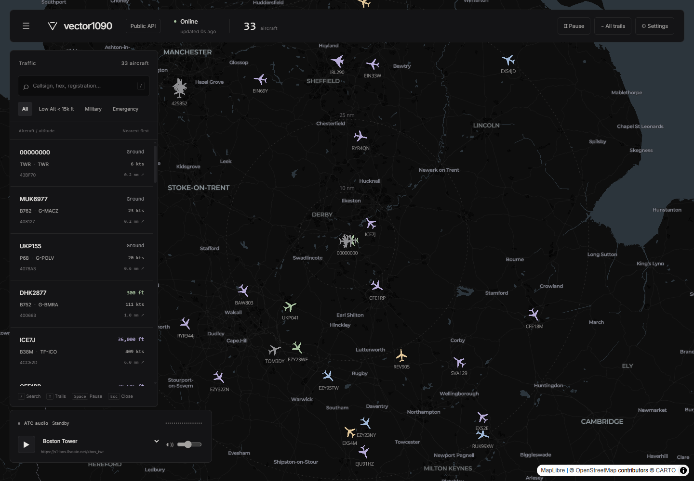
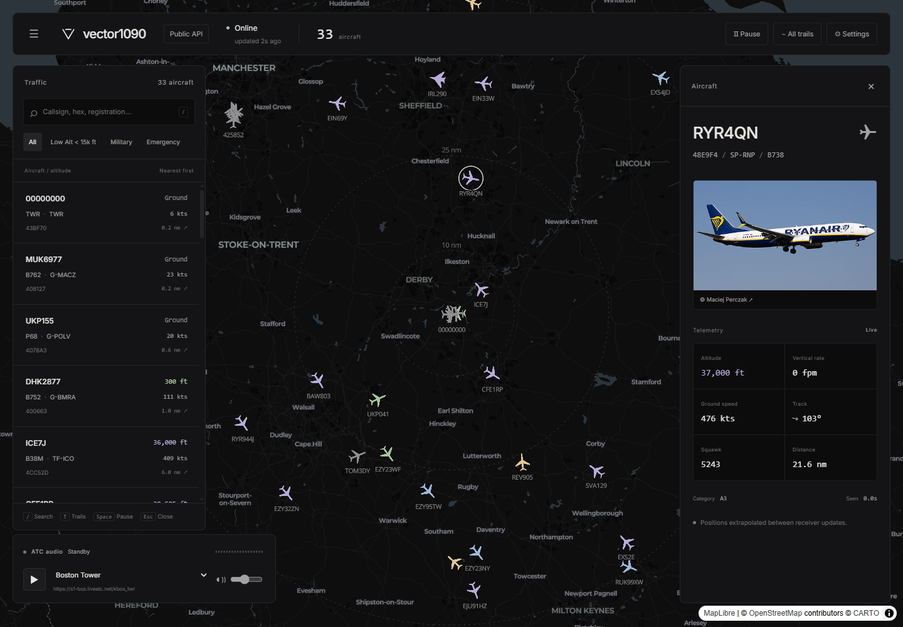

# vector1090

An ADS-B aircraft map with ATC audio, for public feeds or a local receiver.



## Features

- Public adsb.lol feeds or readsb/tar1090 aircraft.json, with pause, rate-limit guards and retry backoff.
- MapLibre map with category silhouettes, altitude colors, range rings, trails and interpolated positions between updates.
- Search and filters, distance-sorted aircraft list, telemetry and credited Planespotters photos.
- ATC audio from a user-supplied URL, with example streams whose availability varies.
- Monochrome panels, pastel data colors, persistent settings and inertial scrolling that respects reduced motion.



Altitude colors: ground/unknown grey; below 5,000 ft sage; 5,000–9,999 ft sand;
10,000–24,999 ft blue; 25,000 ft and above lavender. Emergency squawks use rose.

## Run with Docker

```sh
docker compose up -d
```

Open http://localhost:3000. The image uses Node 22 Alpine and runs as a non-root user.

## Development

Use Node.js 22 (Node 20 or newer is required).

```sh
npm install
npm run dev
```

| Command                | Purpose                                               |
| ---------------------- | ----------------------------------------------------- |
| `npm run dev`          | Development server                                    |
| `npm run build`        | Standalone production build                           |
| `npm run lint`         | Next.js ESLint checks                                 |
| `npm run typecheck`    | TypeScript checks                                     |
| `npm run format`       | Format source, config and documentation with Prettier |
| `npm run format:check` | Check formatting without writing                      |
| `npm test`             | Run offline Vitest tests                              |

For a standalone build, copy `public` and `.next/static` into `.next/standalone`,
then run `node .next/standalone/server.js`. Docker handles this automatically.
See [CONTRIBUTING.md](CONTRIBUTING.md) for the pull-request checklist.

## Controls

| Key    | Action                            |
| ------ | --------------------------------- |
| `/`    | Focus search                      |
| `T`    | Toggle all trails                 |
| Space  | Pause or resume aircraft polling  |
| Escape | Close settings or clear selection |

Shortcuts other than Escape are ignored while typing. Settings and audio preferences
are stored in the browser. Changing feed sources clears old aircraft and trails;
transient failures keep the last received data.

## Local receivers

Set the server's `LOCAL_AIRCRAFT_URL` to a reachable HTTP(S) feed, for example:

```dotenv
LOCAL_AIRCRAFT_URL=http://192.168.1.20/tar1090/data/aircraft.json
ALLOW_CLIENT_LOCAL_URL=false
```

Common receiver paths are `http://<pi>/tar1090/data/aircraft.json` and
`http://<pi>:8080/data/aircraft.json`. Select **Local receiver** in Settings and set
your home location. The server fetches the receiver; browser CORS setup is not needed.

Receiver URLs are **server-managed by default**. The URL field is read-only and the
browser does not send an override. Set `ALLOW_CLIENT_LOCAL_URL=true` only if you need
browser-editable URLs on a trusted deployment. This permits arbitrary HTTP(S)
destinations reachable by the server, including private addresses. There is no built-in
authentication: do not enable this on an untrusted public deployment.

Inside Docker, `localhost` means the container. For a receiver on the host, use
`http://host.docker.internal:8080/data/aircraft.json` or a LAN address.
On Linux, enable the `extra_hosts` hint in Compose. The receiver must listen on an
interface reachable from the container.

## Configuration

Copy `.env.example` to `.env` for server configuration. Browser settings explicitly
send mode, coordinates and radius, taking precedence over these API defaults.

| Variable                 | Default                                                       | Purpose                                          |
| ------------------------ | ------------------------------------------------------------- | ------------------------------------------------ |
| `FEED_MODE`              | `public`                                                      | API's default feed mode                          |
| `ADSB_API_BASE`          | `https://api.adsb.lol`                                        | Public feed base URL                             |
| `ADSB_API_KEY`           | Unset                                                         | Optional public feed API key                     |
| `LOCAL_AIRCRAFT_URL`     | `http://localhost:8080/data/aircraft.json`                    | Server's receiver URL                            |
| `ALLOW_CLIENT_LOCAL_URL` | Disabled; Compose: `false`                                    | Only literal `true` permits client URL overrides |
| `HOME_LAT`               | `52.8311`                                                     | Default latitude                                 |
| `HOME_LON`               | `-1.3281`                                                     | Default longitude                                |
| `HOME_RADIUS_NM`         | `50`                                                          | Default radius; clamped to 1–250 nm              |
| `PHOTO_USER_AGENT`       | `vector1090/1.0 (+https://github.com/Reforge-OSS/vector1090)` | Photo request identification                     |

The aircraft proxy uses the same identifying User-Agent, without a per-request override.
Docker sets `NODE_ENV=production`, `PORT=3000`, `HOSTNAME=0.0.0.0` and
`NEXT_TELEMETRY_DISABLED=1`.

## API

- **`GET /api/aircraft`** accepts `mode`, `lat`, `lon`, `radius` and an opt-in
  local `url`. Returns `{ aircraft: Aircraft[], now, mode, total }` with no caching.
  Coordinates outside valid ranges return 400; upstream rate limits return 429 with
  `{ error: "rate_limited", retryAfter }`; other upstream failures return 502.
  See [the shared types](src/lib/types.ts) for the normalized aircraft fields and
  [normalization](src/lib/normalize.ts) for receiver mappings.
- **`GET /api/photo/[hex]`** accepts six hexadecimal characters and returns
  `{ photo: { thumbnail, large, link, photographer } | null }`. Successful and
  genuine-empty lookups cache for one hour; upstream failures return 502 with
  `Cache-Control: no-store` and can be retried.
- **`GET /api/config`** returns `{ allowClientLocalUrl, localUrlConfigured }` with
  no caching. It never returns the configured receiver URL. The UI stays locked
  if this request fails.

## Customization and layout

Replace `public/logo.svg` to change the mark and favicon; the adjacent wordmark is
plain text in `Logo.tsx`. Colors live in `src/lib/palette.json` and are shared by CSS,
Tailwind and map layers.

- `src/app`: dashboard, global styles and server API routes
- `src/components`: map, aircraft panels, audio and settings
- `src/hooks`: polling, persistence, receiver policy and panel scrolling
- `src/lib`: normalization, geometry, units, filters and photo caching
- `tests`: Vitest library, route and hook tests
- `scripts/prepare-maplibre.mjs`: copies the worker before dev/build; its output is ignored

Built with Next.js 14.2.35, React 18, TypeScript, Tailwind 3, MapLibre 6, Inter and Lenis.
Next.js is pinned; known dependency advisories remain. Review them before public deployment.
ATC playback depends on browser policies, codecs and stream availability. The fallback
visualizer is simulated, not a measurement of audio levels.

## Credits and license

Aircraft data: [adsb.lol](https://adsb.lol/) and its feeders.
Photos: [Planespotters.net](https://www.planespotters.net/) and the credited photographers;
image rights remain with their owners.
Basemap: [CARTO](https://carto.com/attributions) and
[OpenStreetMap contributors](https://www.openstreetmap.org/copyright).
Map rendering: [MapLibre](https://maplibre.org/).
Example audio mounts reference third-party services including
[LiveATC.net](https://www.liveatc.net/); they are not hosted or guaranteed by this project.

MIT. See [LICENSE](LICENSE); third-party content retains its own terms.
